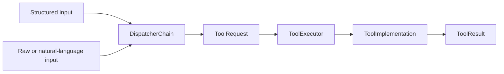

# Run21AI

> Transform human intent into deterministic tool execution.

Run21AI is a lightweight Kotlin-first tool execution engine. A caller can submit a complete structured request or raw input that must first be interpreted, validated, enriched, or routed.

Dispatchers prepare requests. Tools perform real work.

## Why Run21AI

People usually describe work in domain terms rather than formulas, JSON payloads, API contracts, or command-line arguments. Run21AI converts different input forms into one stable `ToolRequest` contract while keeping execution deterministic, testable, and auditable.



Structured input is accepted by a pass-through dispatcher. Raw input may be handled by rule-based, custom, validation, enrichment, or LLM-backed dispatchers. Both modes use the same executor and result contracts.

## Current Capabilities

| Area | Current implementation |
|---|---|
| Core | Framework-independent models, dispatcher chain, registries, execution service, audit metadata, and `ToolCalls` API |
| Tool | Deterministic `formula.evaluate` implementation backed by EvalEx |
| Runtime | Local in-memory composition and Ktor REST API |
| LLM dispatch | Provider-neutral dispatcher plus an Ollama adapter for formula request preparation |
| Client | Independent Rust CLI, `run21ctl` |
| Tests | Kotlin contract/integration tests, Rust CLI tests, and pytest system tests |

## Quick Start

Requirements and optional components are listed in [Installation](docs/INSTALLATION.md).

Start the default REST runtime:

```bash
./gradlew :runtime:rest-api:run
```

Check the service and open the API documentation:

```bash
curl http://127.0.0.1:8080/health
```

```text
http://127.0.0.1:8080/docs
```

Execute the formula tool:

```bash
curl -X POST http://127.0.0.1:8080/v1/executions \
  -H 'Content-Type: application/json' \
  -d '{
    "type": "structured",
    "toolCode": "formula.evaluate",
    "implementationCode": "formula-evalex-v1",
    "input": {
      "expression": "a + b",
      "variables": {"a": 10, "b": 11}
    },
    "actor": {"id": "quick-start-user", "type": "human"},
    "source": {"type": "api", "name": "curl"}
  }'
```

See [Usage](docs/USAGE.md) for structured calls, prompt resolution, REST endpoints, runtime profiles, and CLI commands.

## Build and Test

Run the Gradle test suite:

```bash
./gradlew test
```

Additional Rust and system-test commands are documented in [Testing](docs/TESTING.md).

## Project Structure

| Path | Responsibility |
|---|---|
| `core/` | Framework-independent execution contracts and semantics |
| `tools/` | Concrete tool implementations |
| `dispatchers/` | Request preparation, including provider-neutral and provider-specific LLM adapters |
| `runtime/` | Application composition and transport adapters |
| `clients/` | External clients |
| `tests/system/` | Black-box tests against a running runtime |

## Documentation

- [Installation](docs/INSTALLATION.md)
- [Usage](docs/USAGE.md)
- [Architecture](docs/architecture/README.md)
- [Execution Contracts](docs/architecture/EXECUTION.md)
- [LLM Dispatch](docs/architecture/LLM_DISPATCH.md)
- [Testing](docs/TESTING.md)
- [Roadmap](ROADMAP.md)
- [Changelog](docs/CHANGELOG.md)
- [Development Rules](AGENTS.md)

The machine-readable HTTP contract is owned by [`runtime/rest-api/src/main/resources/openapi.yaml`](runtime/rest-api/src/main/resources/openapi.yaml).
