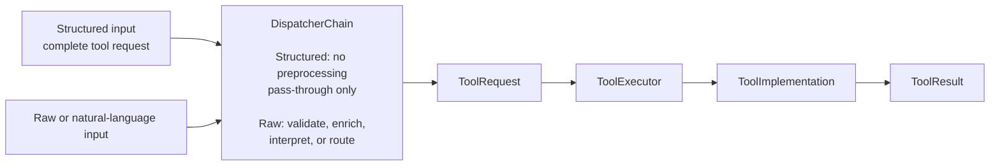

# Run21AI

> **Transform human intent into deterministic tool execution.**

Run21AI is a lightweight Kotlin-first, dispatcher-driven tool execution engine.

It allows the same tool to be called either with a complete structured request or from raw input that first needs validation, enrichment, routing, or interpretation.

Tools perform real work. Dispatchers prepare requests.

## The Problem

People usually think in domain concepts rather than formulas, JSON payloads, API contracts, or command-line arguments.

An accountant may think:

> “Calculate the employee's salary using the base rate, bonus, deductions, and payroll rules.”

A calculator expects an expression. A spreadsheet expects formulas. An API expects structured input.

Run21AI bridges this gap without moving business logic into an LLM or sacrificing deterministic execution, validation, testing, and auditability.

## The Approach

Every input is normalized into the same canonical `ToolRequest`. From that point on, execution is identical.



For structured input, the current core uses `PassThroughDispatcher`: the chain remains part of the execution boundary but does not interpret or transform the request.

For raw input, the chain may contain rule-based, validation, enrichment, custom, or LLM-backed dispatchers.

## Design Principles

- **One execution pipeline.** Structured and dispatcher-based calls converge on the same `ToolRequest`.
- **Dispatchers prepare requests.** They may validate, enrich, interpret, route, accept, or reject input.
- **Tools perform real work.** Business calculations and external operations belong to `ToolImplementation`.
- **LLMs are optional dispatchers.** They may prepare a `ToolRequest`, but they do not produce the final business result.
- **The core is framework-independent.** Ktor, Ollama, EvalEx, persistence, and external SDKs remain outside `:core`.
- **Execution is auditable.** Results include actor, source, dispatcher trace, selected tool, implementation, correlation, and timing metadata.

## Execution Modes

Run21AI exposes two primary ways to enter the same pipeline.

| Mode | API | Input | Dispatcher behavior |
|---|---|---|---|
| Structured | `ToolCalls.execute(...)` | Target tool and complete payload | Pass-through; no interpretation |
| Dispatcher-based | `ToolCalls.dispatch(...)` | Raw or prompt-like input | Validate, enrich, interpret, or route |

### Structured execution

```kotlin
val result = ToolCalls.execute(service) {
    tool(FormulaTool.TOOL_CODE)
    implementation(FormulaTool.IMPLEMENTATION_CODE)

    actor("user-1", ActorType.HUMAN, "User")
    source(ExecutionSourceType.TEST, "readme-example")

    input(FormulaTool.Input.EXPRESSION, "a + b")
    input(
        FormulaTool.Input.VARIABLES,
        mapOf(
            "a" to BigDecimal("10"),
            "b" to BigDecimal("11"),
        ),
    )
}
```

### Dispatcher-based execution

```kotlin
val result = ToolCalls.dispatch(service) {
    prompt("Calculate a + b where a is 10 and b is 11.")

    actor("user-1", ActorType.HUMAN, "User")
    source(ExecutionSourceType.TEST, "readme-example")
}
```

The configured dispatcher chain converts the prompt into the same `ToolRequest` used by structured execution. The registered tool implementation still performs the calculation.

## Core Concepts

| Concept | Responsibility |
|---|---|
| `DispatchInput` | Input accepted by a dispatcher chain |
| `Dispatcher` | Analyzes, validates, enriches, routes, accepts, rejects, or passes input |
| `DispatcherChain` | Processes dispatchers in order and produces a `ToolRequest` or a structured rejection |
| `ToolRequest` | Canonical structured request for execution |
| `ToolExecutor` | Validates the request, resolves an implementation, and builds the final result |
| `ToolImplementation` | Performs deterministic tool-specific work |
| `ToolResult` | Returns status, output or error, and audit metadata |
| `CoreToolRuntime` | Root-level facade over a configured `ToolExecutionService` |
| `ToolCalls` | Recommended high-level API for structured and raw calls |

## Current Modules

| Module | Purpose |
|---|---|
| `:core` | Framework-independent contracts, execution semantics, registries, defaults, audit models, `CoreToolRuntime`, and `ToolCalls` |
| `:tools:formula` | Deterministic formula evaluation tool backed by EvalEx |
| `:runtime:local` | Lightweight local composition of core services and tools |
| `:runtime:rest-api` | Ktor HTTP runtime with health, discovery, resolution, execution, and OpenAPI endpoints |
| `:dispatchers:llm` | Provider-neutral LLM dispatcher |
| `:dispatchers:llm-ollama` | Ollama adapter for the LLM dispatcher |
| `clients/run21ctl` | Independent Rust CLI client for the REST API |
| `tests/system` | Pytest-based black-box tests for the REST API and CLI |

## Quick Start

Start the REST runtime from the project root:

```bash
./gradlew :runtime:rest-api:run
```

Check the service:

```bash
curl http://127.0.0.1:8080/health
```

Open the interactive API documentation:

```text
http://127.0.0.1:8080/docs
```

The raw OpenAPI contract is available at:

```text
http://127.0.0.1:8080/openapi.yaml
```

### Execute the formula tool

```bash
curl -X POST http://127.0.0.1:8080/v1/executions \
  -H 'Content-Type: application/json' \
  -d '{
    "type": "structured",
    "toolCode": "formula.evaluate",
    "implementationCode": "formula-evalex-v1",
    "input": {
      "expression": "a + b",
      "variables": {
        "a": 10,
        "b": 11
      }
    },
    "actor": {
      "id": "quick-start-user",
      "type": "human"
    },
    "source": {
      "type": "api",
      "name": "curl"
    }
  }'
```

## LLM Dispatching

An LLM is not a tool executor in Run21AI. It is one possible dispatcher implementation.

An LLM dispatcher may:

- analyze raw input;
- identify the intended tool;
- extract and normalize parameters;
- enrich metadata;
- reject incomplete or ambiguous input;
- produce a structured `ToolRequest`.

It must not:

- calculate the final business result;
- bypass `ToolExecutor`;
- bypass audit metadata;
- directly perform external operations unless that operation is implemented as a tool.

The provider-neutral implementation lives in `:dispatchers:llm`. The Ollama-specific adapter lives in `:dispatchers:llm-ollama`.

## REST API

The current REST runtime exposes:

```text
GET  /health
GET  /ready
GET  /docs
GET  /openapi.yaml
GET  /v1/tools
GET  /v1/tools/{code}
POST /v1/tool-requests/resolve
POST /v1/executions
```

`POST /v1/tool-requests/resolve` runs only the dispatcher chain and returns a prepared `ToolRequest` or a structured dispatch error.

`POST /v1/executions` resolves the request and executes the selected tool through the common pipeline.

## Build and Test

Run all Gradle tests:

```bash
./gradlew test
```

Run the core contract tests:

```bash
./gradlew :core:test
```

Run the Rust CLI tests:

```bash
cargo test --manifest-path clients/run21ctl/Cargo.toml
```

Run the system tests against an already running backend:

```bash
python -m pytest -c tests/system/pytest.ini tests/system/tests
```

Or let pytest start and stop the backend:

```bash
RUN21_START_SERVER=true \
python -m pytest -c tests/system/pytest.ini tests/system/tests
```

## Documentation

- [Roadmap](ROADMAP.md)
- [Documentation Index](docs/INDEX.md)
- [Requirements](docs/01-requirements/README.md)
- [Core Documentation](docs/02-core/README.md)
- [Architecture](docs/03-architecture/README.md)
- [API Documentation](docs/05-api/README.md)
- [Tool Documentation](docs/06-tools/README.md)
- [Testing Documentation](docs/08-testing/README.md)

## Project Direction

Run21AI is evolving toward a lightweight execution platform where different forms of input can be converted into stable, auditable, deterministic tool calls without coupling business execution to a particular UI, framework, rule engine, or LLM provider.

The central contract remains:

> Dispatchers prepare requests. Tools perform work.
